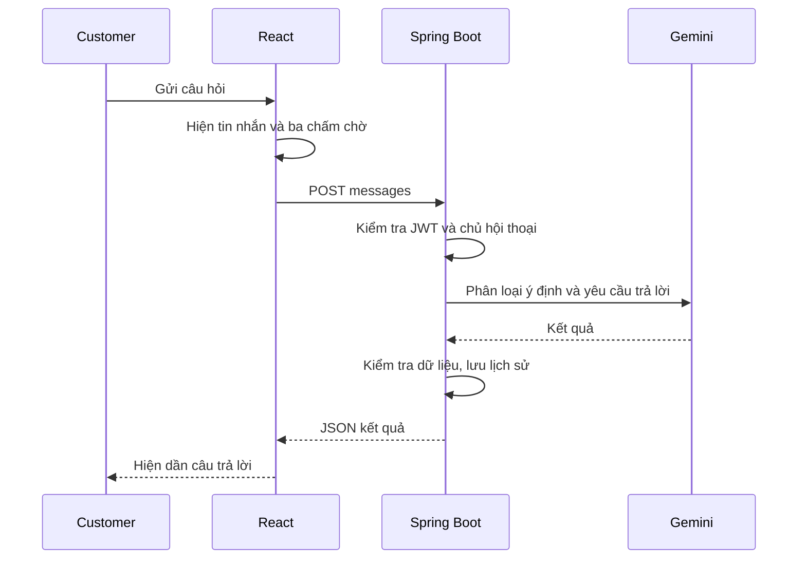
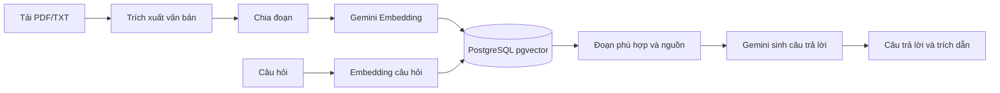

# SmartPhone AI — User Guide

Hướng dẫn cài đặt, sử dụng và giải thích code phục vụ demo project cuối kỳ. Phiên bản cập nhật ngày 09/11/2026 sử dụng Google Gemini cho Chat Model và Embedding Model.

## 1. Phạm vi và tài khoản

Ứng dụng bán điện thoại, đặt hàng COD và tư vấn AI có truy xuất tài liệu. CUSTOMER mua hàng, quản lý hồ sơ, đơn hàng và hội thoại. ADMIN quản lý cửa hàng trong dashboard.

| Người sử dụng | Thao tác chính |
| --- | --- |
| Guest | Xem, tìm kiếm, so sánh điện thoại, dùng giỏ hàng, đăng ký và đăng nhập |
| CUSTOMER | Đặt hàng, theo dõi đơn, sửa thông tin liên hệ, chat AI và xóa hội thoại của mình |
| ADMIN | Quản lý sản phẩm, thương hiệu, tài khoản, đơn hàng, bảo trì, tài liệu và cấu hình Gemini |

Đăng nhập dùng email và mật khẩu. OTP dùng cho đăng ký và quên mật khẩu. Admin tạo tài khoản bằng email mời người nhận tự đặt mật khẩu. Admin gốc được tạo bằng cấu hình khởi tạo trong `BE/.env`.

## 2. Chuẩn bị môi trường

| Thành phần | Yêu cầu |
| --- | --- |
| Java | JDK 21 trở lên |
| Maven | 3.9 trở lên |
| Node.js | 22.12 trở lên, kèm npm |
| Database | PostgreSQL có extension pgvector |
| Email | Gmail gửi thư và App Password cho OTP, lời mời |
| AI | Gemini API key và model tài khoản được phép sử dụng |
| Bản đồ | Internet, Geoapify API key nếu sử dụng gợi ý địa chỉ |

Kiểm tra các công cụ trong terminal.

```powershell
java -version
mvn -version
node -v
npm -v
```

Clone repository rồi mở terminal tại thư mục gốc có `BE` và `FE`. Với database đang có dữ liệu, tạo bản sao trước khi chạy các migration mới. Migration V20 xóa tài khoản STAFF/MANAGER cũ và dữ liệu liên quan. Các migration sau bổ sung JWT, trạng thái tài khoản, ảnh và vị trí địa chỉ.

### 2.1. Database

Trong pgAdmin hoặc psql, tạo database `smartphone_ai`. Chạy câu lệnh tạo database ở kết nối quản trị, sau đó chuyển vào database mới để bật pgvector.

```sql
CREATE DATABASE smartphone_ai;
```

```sql
CREATE EXTENSION IF NOT EXISTS vector;
SELECT extversion FROM pg_extension WHERE extname = 'vector';
```

Extension cần được cài cho đúng phiên bản PostgreSQL trước khi chạy câu lệnh. Flyway tạo bảng khi khởi động BE.

### 2.2. File môi trường backend

Nếu đã nhận `BE/.env` riêng từ người phụ trách, đặt file vào thư mục `BE`. Khi cấu hình lần đầu, sao chép mẫu.

```powershell
Copy-Item BE/.env.example BE/.env
```

Điền các nhóm biến sau bằng giá trị trên máy của bạn.

| Biến | Cách sử dụng |
| --- | --- |
| `DB_URL` | `jdbc:postgresql://localhost:5432/smartphone_ai` |
| `DB_USERNAME`, `DB_PASSWORD` | Tài khoản PostgreSQL local |
| `SMTP_USERNAME` | Gmail gửi OTP và lời mời |
| `SMTP_PASSWORD` | Google App Password của Gmail gửi thư |
| `ROOT_ADMIN_EMAIL`, `ROOT_ADMIN_PASSWORD` | Thông tin tạo Admin gốc lần đầu, mật khẩu tối thiểu 8 ký tự |
| `AI_CONFIG_ENCRYPTION_KEY` | Khóa mã hóa API key trong DB, Base64 của 32 byte ngẫu nhiên |
| `JWT_SECRET` | Khóa ký JWT riêng, Base64 của ít nhất 32 byte ngẫu nhiên |
| `AUTH_COOKIE_SECURE` | `false` khi chạy localhost HTTP, `true` cho HTTPS |
| `GEOAPIFY_API_KEY` | Khóa tìm kiếm địa chỉ, tùy chọn |
| `PRODUCT_IMAGES_DIRECTORY` | Mặc định `./uploads/product-images` tính từ thư mục chạy BE |

Tạo mỗi khóa bằng một lần chạy đoạn PowerShell sau. Chạy hai lần riêng để có giá trị cho `AI_CONFIG_ENCRYPTION_KEY` và `JWT_SECRET`.

```powershell
$secretBytes = New-Object byte[] 32
$secretGenerator = [System.Security.Cryptography.RandomNumberGenerator]::Create()
$secretGenerator.GetBytes($secretBytes)
[Convert]::ToBase64String($secretBytes)
$secretGenerator.Dispose()
```

Giữ ổn định `AI_CONFIG_ENCRYPTION_KEY` theo database để giải mã API key đã lưu. File `.env` dùng `KEY=value`, giá trị trực tiếp và dấu gạch chéo ngược viết thành `\\`. Khởi động lại BE sau khi sửa. Biến môi trường của terminal hoặc IntelliJ có ưu tiên cao hơn file.

Gmail gửi thư cần bật xác minh hai bước, tạo App Password rồi điền vào `SMTP_PASSWORD`. Khách đăng ký dùng email của họ để nhận OTP từ Gmail gửi thư này. Xem hướng dẫn Google khi tạo App Password. [Hỗ trợ Google](https://support.google.com/accounts/answer/185833)

Các file `.env` được chia sẻ riêng. Gemini API key được nhập trong Admin và mã hóa trong DB. Các giá trị `VITE_*` là cấu hình công khai của trình duyệt.

### 2.3. Chạy backend

```powershell
cd BE
mvn spring-boot:run
```

Chờ terminal hiển thị ứng dụng khởi động thành công tại cổng 8080. BE đọc `.env` khi working directory là thư mục `BE` hoặc thư mục gốc dự án.

### 2.4. Chạy frontend

Mở terminal khác tại thư mục gốc.

```powershell
cd FE
npm ci
Copy-Item .env.example .env
npm run dev
```

Nếu `FE/.env` đã được cấu hình, dùng file hiện có. Cấu hình mặc định kết nối API thật như sau.

```dotenv
VITE_API_BASE_URL=/api
VITE_API_TARGET=http://localhost:8080
VITE_ENABLE_MOCK_API=false
```

Mở `http://localhost:5173`. Vite proxy `/api` tới BE. Đổi `VITE_API_TARGET` khi BE dùng địa chỉ khác rồi khởi động lại Vite. File `.env.local` có ưu tiên cao hơn `.env`.

### 2.5. Dữ liệu điện thoại

Sau khi BE tạo schema, mở Query Tool của database local trong pgAdmin và chạy toàn bộ `datasets/phones/import.sql`. Có thể dùng psql từ thư mục gốc.

```powershell
psql -h localhost -U postgres -d smartphone_ai -f datasets/phones/import.sql
```

Dataset đã chuẩn hóa 138 điện thoại, giá VNĐ minh họa và ảnh trong `FE/public/images/phones`. Đọc quy tắc nhập và nguồn dữ liệu trước khi nhập vào DB có sản phẩm hiện hữu. [Hướng dẫn dataset](datasets/phones/README.md)

## 3. Cấu hình Gemini

### 3.1. Chat Model

1. Tạo API key trong Google AI Studio bằng tài khoản Google của bạn. Kiểm tra model được project hỗ trợ. [Google AI Studio](https://aistudio.google.com/apikey)
2. Đăng nhập Admin bằng `ROOT_ADMIN_EMAIL` và mật khẩu khởi tạo, mở **Cấu hình AI** tại `/admin/ai-settings`.
3. Điền Chat Model bằng đúng mã model trong tài khoản, nhập API key vào ô key mới.
4. Bấm **Lưu cấu hình**, sau đó **Kiểm tra kết nối**. BE gửi một yêu cầu thử tới Gemini.
5. Khi kiểm tra thành công, bấm **Kích hoạt** và xác nhận. Yêu cầu chat mới sử dụng cấu hình đã kích hoạt.

Để trống ô key mới khi muốn dùng key đã lưu. Ô key đã lưu hiển thị giá trị che. Key dự phòng là tùy chọn, dùng cùng model. Khi key chính trả HTTP 429, BE thử key dự phòng một lần. Các key Gemini trong cùng project dùng chung hạn mức. [Tài liệu API key](https://ai.google.dev/gemini-api/docs/api-key), [Model Gemini](https://ai.google.dev/gemini-api/docs/models), [Giới hạn sử dụng](https://ai.google.dev/gemini-api/docs/rate-limits)

### 3.2. Embedding Model

1. Mở **Cấu hình embedding** tại `/admin/embedding`.
2. Chọn model embedding Gemini mà project của bạn hỗ trợ. Ví dụ `gemini-embedding-001` với 768 chiều, nếu model này còn được cấp cho project.
3. Nhập số chiều khớp model và key có quyền gọi embedding. Có thể dùng cùng Gemini key khi project hỗ trợ cả chat và embedding.
4. Bấm nút kiểm tra và lưu. BE tạo vector thử, kiểm tra đủ số chiều và lưu cấu hình.
5. Nếu đổi model hoặc số chiều sau khi đã tải tài liệu, lập chỉ mục lại các tài liệu để vector khớp cấu hình mới.

Chat Model sinh câu trả lời. Embedding Model biến văn bản thành vector phục vụ tìm tài liệu theo ý nghĩa. Hai mục cấu hình riêng vì mỗi mục gọi tác vụ khác nhau. [Hướng dẫn embedding Google](https://ai.google.dev/gemini-api/docs/embeddings)

### Chuyển từ phiên bản có OpenAI

Cấu hình OpenAI cũ hiển thị như chưa cấu hình Gemini. Nhập key Gemini mới cho Chat, thực hiện Lưu cấu hình, Kiểm tra kết nối và Kích hoạt. Trong cấu hình embedding, nhập key và model Gemini mới rồi lưu, sau đó lập chỉ mục lại tài liệu đã có. Ô key để trống chỉ tái sử dụng key Gemini đã lưu đúng mục cấu hình. Giữ `AI_CONFIG_ENCRYPTION_KEY` theo database để đọc cấu hình Gemini hiện có.

### 3.3. Tải tài liệu RAG

1. Chuẩn bị TXT UTF-8 hoặc PDF có thể trích xuất văn bản. Giới hạn 10 MiB, PDF tối đa 200 trang.
2. Vào **Kho kiến thức AI** tại `/admin/knowledge`, chọn file tải lên.
3. Theo dõi `PROCESSING` đến `READY`. Khi `FAILED`, xem lại file, model, key và số chiều rồi lập chỉ mục lại.
4. Dùng bật/tắt để chọn tài liệu được phép truy xuất. Thay nội dung tài liệu sẽ tạo lại embedding.
5. Đăng nhập CUSTOMER, chọn **Hỗ trợ cửa hàng** và hỏi nội dung có trong tài liệu. Câu trả lời đủ căn cứ hiển thị tên nguồn và số trang nếu có.

Có file mẫu `FE/public/demo/Chinh-sach-minh-hoa.txt` để thử luồng tải file. File này ghi rõ dữ liệu minh họa. Để demo một chính sách cụ thể, dùng tài liệu do nhóm tự xác nhận và hỏi câu có câu trả lời trong tài liệu đó. PDF scan ảnh cần được OCR trước khi tải.

## 4. Sử dụng chat AI

Đăng nhập CUSTOMER, vào **Tư vấn AI** rồi chọn chủ đề.

| Chủ đề | Cách dùng | Nguồn câu trả lời |
| --- | --- | --- |
| Tư vấn mua điện thoại | Hỏi chọn máy, so sánh hoặc kiến thức công nghệ | Catalog, tài liệu liên quan và kiến thức Gemini |
| Hỗ trợ cửa hàng | Hỏi chính sách bảo hành, giao hàng, đổi trả đã tải | RAG từ tài liệu đang bật và `READY` |

Ví dụ hỏi tư vấn “Tôi có 10 triệu, cần điện thoại pin tốt để học và chụp ảnh”. Hệ thống ưu tiên máy trong mức tiền. Máy vượt tối đa 10% được ghi số tiền và tỷ lệ vượt. Giá tại shop được lấy từ catalog.

Tư vấn mua điện thoại chỉ xử lý nội dung liên quan điện thoại như chọn mua, so sánh, cấu hình, pin, camera và cách sử dụng. Câu hỏi nối tiếp được xét theo ngữ cảnh, ví dụ “Còn pin thì sao?” sau khi đang nói về một mẫu máy. Với câu hỏi ngoài phạm vi như thời tiết, nấu ăn hoặc viết bài văn, hệ thống trả lời “Mình chỉ hỗ trợ tư vấn về điện thoại, như chọn mua, so sánh, cấu hình và cách sử dụng. Bạn muốn tìm hiểu điện thoại nào?”. Câu hỏi về chính sách cửa hàng được đề nghị chuyển sang Hỗ trợ cửa hàng.

Gửi bằng nút gửi hoặc Enter, dùng Shift+Enter để xuống dòng. Tin nhắn của bạn xuất hiện ngay. Ba chấm chuyển động báo AI đang xử lý, sau khi BE trả kết quả, giao diện hiển thị dần câu trả lời. Khi gửi lỗi, dùng thao tác thử lại trên tin nhắn. Hội thoại cũ hiển thị nội dung đã lưu khi mở lại.

BE trả JSON hoàn chỉnh. Hiệu ứng chữ hiện dần chạy ở FE sau khi nhận kết quả. Trình duyệt bật giảm chuyển động sẽ được ưu tiên khi hiển thị hiệu ứng.

Khi mất kết nối hoặc gateway trả lỗi chưa xác định, nút thử lại kiểm tra lịch sử trước. Nếu máy chủ đã lưu câu trả lời, giao diện khôi phục kết quả. Khi trạng thái xử lý còn chưa rõ, giữ tin nhắn và chờ kiểm tra lại hoặc mở hội thoại mới. Lỗi nghiệp vụ có mã xác định từ BE cho phép gửi lại sau khi kiểm tra lịch sử để tránh tạo câu hỏi trùng.

Nếu câu hỏi khác chủ đề, ứng dụng đề nghị chuyển. Xác nhận tạo hội thoại theo chủ đề mới và xử lý câu hỏi đã gửi. Bạn có thể hủy để giữ chủ đề hiện tại. Nút xóa trong lịch sử yêu cầu xác nhận và xóa hội thoại của chính tài khoản.

Thông tin công nghệ của Gemini cần được đối chiếu khi quyết định mua. Các nguồn RAG hiển thị giúp người dùng kiểm tra câu trả lời. Khi tài liệu thiếu căn cứ, Hỗ trợ cửa hàng thông báo chưa đủ thông tin.

## 5. Mua hàng và quản trị

### 5.1. Customer

1. Tìm điện thoại, lọc theo thương hiệu, giá và thông số. Máy Hết hàng vẫn hiển thị để tra cứu.
2. Chọn dung lượng, màu và số lượng, thêm vào giỏ. Khi đăng nhập, giỏ Guest được hợp nhất với giỏ tài khoản.
3. Chọn sản phẩm cần mua và tiến hành đặt hàng, nhập họ tên, số điện thoại, địa chỉ nhận hàng và ghi chú.
4. Chọn gợi ý địa chỉ để điền địa chỉ và ghim bản đồ. Chọn điểm trực tiếp trên bản đồ hoặc dùng **Vị trí hiện tại** sẽ lấy địa chỉ theo tọa độ rồi điền vào form. Trong lúc lấy địa chỉ, nút lưu/kiểm tra đơn tạm khóa. Chọn điểm mới, nhập tay hoặc hủy sửa hồ sơ sẽ hủy kết quả cũ. Nếu lỗi hoặc quá thời gian chờ, nhập địa chỉ thủ công. Vị trí là tùy chọn, cần kiểm tra lại vì dữ liệu địa chỉ có thể sai lệch.
5. Bấm **Kiểm tra đơn hàng** để BE kiểm tra giá, tình trạng bán và thông tin nhận hàng. Sau khi xem lại tổng tiền, bấm **Xác nhận đặt hàng** để tạo đơn COD.
6. Xem lịch sử đơn mới nhất trước, mở chi tiết và hủy khi đơn còn `PENDING`.

Trong hồ sơ, bấm **Chỉnh sửa thông tin** để sửa họ tên, số điện thoại và địa chỉ. Email được khóa. Hủy khôi phục dữ liệu đã lưu. Đổi mật khẩu đăng xuất các thiết bị khác, đặt lại mật khẩu qua OTP thu hồi các phiên cũ.

Quên mật khẩu gồm ba bước. Nhập email để nhận mã, nhập OTP và bấm **Xác thực OTP**, sau đó đặt mật khẩu mới và nhập xác nhận. Hai ô mật khẩu có nút ẩn/hiện riêng, yêu cầu tối thiểu 8 ký tự. Quyền đặt lại mật khẩu dùng một lần và hết hạn sau 5 phút kể từ khi xác thực OTP. Khi hết hạn, bấm **Yêu cầu mã xác minh mới** để bắt đầu lại. Tại bước OTP, bấm **Đổi email** nếu cần sửa địa chỉ nhận mã.

### 5.2. Admin

| Mục | Thao tác |
| --- | --- |
| Tổng quan | Theo dõi số lượng sản phẩm, đơn và tài liệu |
| Sản phẩm | Thêm/sửa thông số, phiên bản, giá, ảnh, Đang mở bán/Hết hàng, xóa cứng có xác nhận |
| Thương hiệu | Thêm, sửa, xóa theo ràng buộc dữ liệu |
| Tài khoản | Tạo và gửi email đặt mật khẩu, đổi CUSTOMER/ADMIN, vô hiệu hóa và cho hoạt động lại |
| Đơn hàng | Xem thông tin giao hàng, cập nhật trạng thái theo luồng cho phép |
| Bảo trì | Bật/tắt màn hình Shop đang bảo trì, tiếp tục sử dụng dashboard |
| Kho kiến thức | Tải/thay nội dung, bật/tắt, lập chỉ mục lại và xóa tài liệu |
| Cấu hình AI | Lưu, kiểm tra, kích hoạt Gemini và key dự phòng |
| Cấu hình embedding | Kiểm tra, lưu model và số chiều Gemini |

Ảnh PNG/JPEG/WebP tối đa 5 MiB mỗi file. Chọn ảnh từ máy, chờ tải xong rồi lưu sản phẩm. File ảnh lưu ở thư mục uploads theo cấu hình. Khi sao lưu/chuyển máy, giữ cả database, khóa mã hóa và thư mục ảnh. Xóa sản phẩm giữ snapshot đơn đã đặt, gỡ sản phẩm khỏi giỏ và vô hiệu bản kiểm tra đơn liên quan. File ảnh có thể còn được tham chiếu nên tồn tại độc lập trên đĩa.

## 6. Giải thích code

### 6.1. Cấu trúc

```text
BE/src/main/java/com/smartphoneai/
  controller/        REST API và kiểm tra request
  service/           Interface nghiệp vụ
  service/impl/      Xử lý nghiệp vụ và giao dịch
  service/support/  Mã hóa, model embedding, trích xuất tài liệu
  repository/        Truy cập database
  entity/            Entity và trạng thái dữ liệu
  config/            JWT, phân quyền, bootstrap, bảo trì
FE/src/
  app/               Router, guard và QueryClient
  layouts/           Cửa hàng, dashboard, hội thoại
  pages/             Các màn hình nghiệp vụ
  features/          Auth, sản phẩm, giỏ, AI chat
  shared/api/        Hợp đồng API, HTTP client, adapter thật
  shared/components/ Thành phần giao diện dùng chung
  mocks/             Backend giả cho chế độ demo
```

### 6.2. Chat qua Gemini



Các điểm đọc code chính nằm tại `FE/src/features/ai-chat/hooks/useChat.ts`, `FE/src/pages/ai/ChatPage.tsx`, `BE/.../controller/AiChatController.java` và `BE/.../service/impl/AiChatServiceImpl.java`.

`TopicRouterImpl` xác định cùng chủ đề, khác chủ đề hoặc cần hỏi rõ. `ChatResponderImpl` chuyển Hỗ trợ cửa hàng vào RAG và Tư vấn mua điện thoại vào `PhoneAssistanceServiceImpl`. `AiProviderServiceImpl` lấy cấu hình Gemini hoạt động, giải mã key tại BE và điều phối retry. `SpringAiProviderClient` gọi Gemini thông qua Spring AI.

### 6.3. RAG



`KnowledgeTextExtractor` đọc TXT/PDF, chia đoạn 1.500 ký tự Unicode và chồng lấn 200 ký tự. `KnowledgeIndexWorkerImpl` tạo chunks, gọi embedding và đánh dấu tài liệu READY. `SpringAiKnowledgeVectorStore` ghi vector và tìm tương đồng theo phiên bản embedding. `RagServiceImpl` chỉ dùng tài liệu READY phù hợp phiên bản, chọn nguồn có điểm phù hợp và kiểm tra chunk ID mà AI trích dẫn. Mặc định truy xuất dùng ngưỡng tương đồng 0,72.

### 6.4. Các API cần trình bày

| API | Vai trò |
| --- | --- |
| `POST /api/auth/login` | Đăng nhập, cấp cookie xác thực |
| `POST /api/auth/refresh` | Xoay refresh token và cấp access JWT |
| `POST /api/ai/conversations` | Tạo hội thoại theo chủ đề |
| `POST /api/ai/conversations/{id}/messages` | Gửi câu hỏi |
| `POST /api/ai/topic-switches/{id}/confirm` | Xác nhận chuyển chủ đề |
| `DELETE /api/ai/conversations/{id}` | Xóa hội thoại của mình |
| `GET/PUT /api/admin/ai-settings` | Xem/lưu cấu hình Gemini |
| `POST /api/admin/ai-settings/test` | Kiểm tra key và model |
| `POST /api/admin/ai-settings/activate` | Kích hoạt cấu hình đã kiểm tra |
| `GET/PUT /api/admin/embedding-settings` | Xem/kiểm tra/lưu embedding |
| `POST /api/admin/knowledge/documents` | Tải tài liệu RAG |
| `POST /api/orders/preview` | Kiểm tra đơn trước khi đặt |
| `POST /api/orders` | Xác nhận đơn với idempotency key |

Access JWT hạn 15 phút, refresh token xoay vòng hạn 7 ngày trong cookie HttpOnly và SameSite Strict. FE lấy CSRF và gửi header cho thao tác thay đổi. Backend kiểm tra quyền và phiên bản thông tin xác thực theo tài khoản. Đọc `FE/src/shared/api/httpClient.ts` và các lớp auth/security trong BE khi trình bày phần này.

## 7. Kịch bản demo cuối kỳ

| Bước | Thao tác | Điều cần quan sát |
| --- | --- | --- |
| 1 | Chạy BE và FE, đăng nhập Admin | Dashboard và danh mục hiện dữ liệu |
| 2 | Lưu Gemini, kiểm tra và kích hoạt | Toast thành công, cấu hình hoạt động, key đã che |
| 3 | Cấu hình embedding, tải tài liệu của nhóm | Tài liệu chuyển PROCESSING sang READY |
| 4 | Đăng nhập Customer, hỏi tư vấn hoặc kiến thức điện thoại | Tin nhắn hiện ngay, ba chấm chờ, câu trả lời hiện dần |
| 5 | Hỏi Hỗ trợ cửa hàng đúng nội dung tài liệu | Câu trả lời kèm tên nguồn và trang nếu có |
| 6 | Hỏi thông tin chính sách chưa có tài liệu | Phản hồi chưa đủ căn cứ |
| 7 | Hỏi khác chủ đề, xác nhận chuyển | Hội thoại mới, câu hỏi được xử lý |
| 8 | Đặt một đơn COD, mở lịch sử | Giá được kiểm tra ở BE, đơn được tạo và xem lại được |

Phiên bản theo yêu cầu hiện tại chỉ triển khai Gemini. Tiêu chí trong ảnh đề bài yêu cầu hoán chuyển nền tảng chat giữa các nhà cung cấp cần được trao đổi lại với giảng viên khi chốt phạm vi nộp. Thay model hoặc key trong Gemini là thay cấu hình cùng nền tảng.

## 8. Kiểm thử và xử lý lỗi

Chạy trong terminal tại các thư mục tương ứng.

```powershell
# BE
mvn verify
```

```powershell
# FE
npm test
npm run build
npm run test:e2e
```

E2E demo dùng Chrome và dữ liệu giả. `npm run test:integration` cần BE và SMTP thử nghiệm theo phần hướng dẫn kiểm thử trong README FE. Khi nghiệm thu thực tế, xác nhận riêng Gmail, Gemini, embedding và PostgreSQL/pgvector bằng dữ liệu thử phù hợp.

| Biểu hiện | Kiểm tra và xử lý |
| --- | --- |
| FE không kết nối được | BE có chạy 8080, `VITE_API_TARGET`, quyền mạng, khởi động lại Vite |
| Đăng nhập thất bại | Email, mật khẩu, trạng thái tài khoản, cấu hình Admin chỉ khởi tạo lần đầu |
| Đăng ký/quên mật khẩu lỗi gửi mail | SMTP_USERNAME, App Password, quyền mạng tới smtp.gmail.com, terminal BE |
| AI chưa được cấu hình | Lưu Gemini, kiểm tra kết nối và kích hoạt |
| Model không hợp lệ/không có quyền | Mã model và quyền project trong AI Studio |
| HTTP 429 | Hạn mức project/model, chờ phục hồi hoặc dùng key dự phòng thuộc project có hạn mức phù hợp |
| HTTP 503 từ AI | Theo dõi lỗi provider, chờ rồi thử lại |
| RAG chưa có nguồn | Embedding hợp lệ, tài liệu READY đang bật, câu hỏi liên quan nội dung |
| Tài liệu FAILED sau đổi embedding | Lập chỉ mục lại bằng cấu hình embedding mới |
| Lỗi giải mã key đã lưu | Kiểm tra AI_CONFIG_ENCRYPTION_KEY đang khớp database |
| Vị trí GPS thất bại | Quyền vị trí website, dịch vụ Location Windows và thời gian chờ |
| Gợi ý địa chỉ lệch số nhà | Kiểm tra và chỉnh điểm ghim, bổ sung hướng dẫn giao hàng |
| Ảnh đã tải bị mất sau chuyển máy | Khôi phục thư mục PRODUCT_IMAGES_DIRECTORY cùng database |

## 9. Chế độ xem giao diện

Đặt `VITE_ENABLE_MOCK_API=true` trong `FE/.env.local`, khởi động lại Vite rồi dùng tài khoản demo.

| Vai trò | Email | Mật khẩu |
| --- | --- | --- |
| Customer | `customer@demo.vn` | `Demo123!` |
| Admin | `admin@demo.vn` | `Demo123!` |

Chế độ này lưu dữ liệu trong phiên tab và hiển thị nhãn demo. Câu trả lời, nguồn, key và kiểm tra provider đều là minh họa. Khi demo Gemini và RAG thật, đặt `VITE_ENABLE_MOCK_API=false`, chạy BE và dùng tài khoản thật trong database local.
